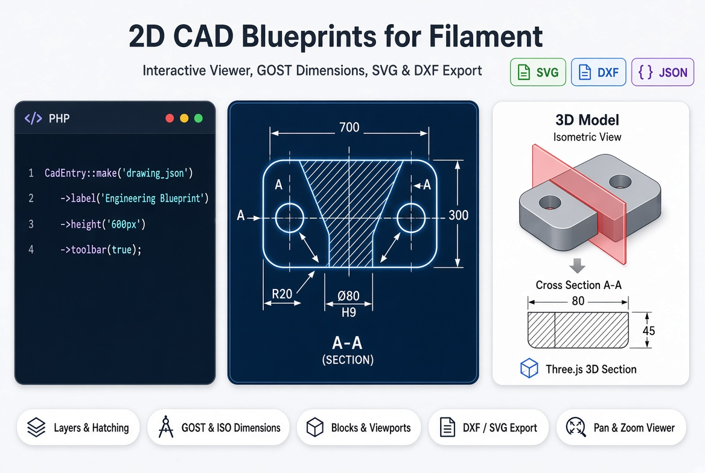
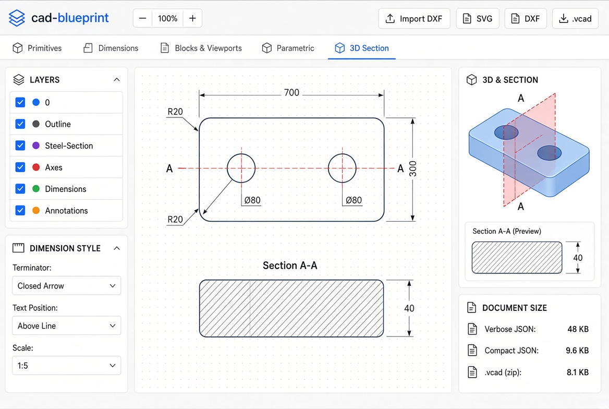

<div class="filament-hidden">



# Filament CAD Blueprint

[](https://packagist.org/packages/maxim-tsatsura/filament-cad-blueprint)
[](https://packagist.org/packages/maxim-tsatsura/filament-cad-blueprint)
[](https://www.npmjs.com/package/cad-blueprint)
[](./LICENSE)

</div>

Integration of the lightweight parametric 2D CAD blueprint engine [`cad-blueprint`](https://www.npmjs.com/package/cad-blueprint) for Filament.

Render interactive engineering drawings, product configurator blueprints, cross-sections, and technical schemas directly inside Filament Forms and Infolists — with smooth pan & zoom, layer management, GOST & ISO dimension styles, and one-click SVG / DXF export.

- **[Live Engine Demo](https://maks-t.github.io/cad-blueprint/)**
- **[Engine Documentation](https://maks-t.github.io/cad-blueprint/docs.html)**
- **[Core NPM Package (`cad-blueprint`)](https://www.npmjs.com/package/cad-blueprint)**



## Features

- **Interactive Pan & Zoom Viewer:** Mouse wheel zoom to cursor, drag-to-pan, double-click to fit, and pinch-to-zoom on touch screens.
- **Lazy-Loaded Assets (`x-load`):** The CAD engine bundle is loaded asynchronously on demand only on pages that render a blueprint.
- **Infolist & Form Components:** Ready-to-use `CadEntry` for read-only views and `CadViewerField` for reactive Livewire forms.
- **Two-Way Livewire Integration:** Automatically updates the drawing when Livewire state changes (preserving current zoom/pan) and dispatches `cad-object-selected` events when users click entities with an `id`.
- **Built-in Export:** One-click download to **SVG** (paper-accurate millimeters) and **DXF** (R2007 UTF-8 / R2000).
- **Layer Control:** Show, hide, or isolate CAD layers (`Outline`, `Axes`, `Dimensions`, `Hatching`) directly in the viewer.
- **Zero Node.js Requirement:** Pre-compiled standalone ESM bundle included — works out of the box via `php artisan filament:assets`.

## Installation

Install the package via Composer and publish the Filament assets:

```bash
composer require maxim-tsatsura/filament-cad-blueprint
php artisan filament:assets
```

Optionally, you can publish the configuration file:

```bash
php artisan vendor:publish --tag="filament-cad-blueprint-config"
```

## Usage

### Infolist Entry (Read-only CAD Viewer)

Use `CadEntry` inside your resource Infolist to display a blueprint stored as a compact JSON string (generated by `stringifyDocument(doc)` from `cad-blueprint`):

```php
use MaximTsatsura\FilamentCadBlueprint\Infolists\Components\CadEntry;
use Filament\Infolists\Infolist;

public static function infolist(Infolist $infolist): Infolist
{
    return $infolist->schema([
        CadEntry::make('drawing_json')
            ->label('Engineering Blueprint')
            ->height('600px')
            ->toolbar(true)
            ->paperColor('#ffffff')
            ->fitMargin(16),
    ]);
}
```

### Form Field (Reactive CAD Viewer)

Use `CadViewerField` inside Filament forms. When the underlying state is updated in Livewire (for example, when recalculating a parametric drawing from form inputs), the viewer smoothly updates the blueprint while keeping the user's current zoom and pan position:

```php
use MaximTsatsura\FilamentCadBlueprint\Forms\Components\CadViewerField;
use Filament\Forms\Form;

public static function form(Form $form): Form
{
    return $form->schema([
        CadViewerField::make('drawing_json')
            ->label('Product Blueprint')
            ->height('550px')
            ->toolbar(true)
            ->paperColor('#ffffff')
            ->fitMargin(24),
    ]);
}
```

### Dynamic Configuration with Closures

All configuration methods (`height()`, `toolbar()`, `paperColor()`, `fitMargin()`) accept closures that receive standard Filament utilities (`$record`, `$get`, `$state`):

```php
CadEntry::make('drawing_json')
    ->height(fn ($record): string => $record->is_detailed ? '750px' : '450px')
    ->toolbar(fn (): bool => auth()->user()->can('export_blueprints'))
```

### Listening to Object Selection in Livewire

When a user clicks on a CAD entity that has an `id` assigned, the viewer dispatches a `cad-object-selected` Livewire event with the entity's `id`, `layer`, and model coordinates `[x, y]`:

```php
use Livewire\Attributes\On;

#[On('cad-object-selected')]
public function onCadObjectSelected(string $id, ?string $layer, array $point): void
{
    // Example: highlight or open settings for the clicked part ID
    $this->selectedPartId = $id;
}
```

### Panel Plugin Registration (Optional)

While `CadEntry` and `CadViewerField` work as standalone components out of the box, you can optionally register the plugin in your `PanelProvider` to configure panel-wide defaults:

```php
use MaximTsatsura\FilamentCadBlueprint\CadBlueprintPlugin;

public function panel(Panel $panel): Panel
{
    return $panel
        // ...
        ->plugin(
            CadBlueprintPlugin::make()
                ->defaultScale('1:10')
                ->gost(true)
        );
}
```

## Generating Blueprints (`cad-blueprint`)

Drawings can be generated on the frontend, in a Node.js worker/microservice, or imported from DXF using the [`cad-blueprint`](https://www.npmjs.com/package/cad-blueprint) engine and saved as compact JSON in a database column (`text` / `json`):

```ts
import { CadDocument, CadPath, polygon, dimLinear, stringifyDocument } from 'cad-blueprint';

const doc = new CadDocument({ gost: true, settings: { scale: '1:10' } });
doc.layers.create('Outline', { color: '#0f172a', lineWeight: 0.5 });
doc.layers.create('Dimensions', { color: '#0284c7', lineWeight: 0.2 });

const part = CadPath.start(0, 0).right(700).up(300).left(700).close().filletAll(20).build();
doc.addSheet('Main', [
    polygon(part, { layer: 'Outline', id: 'plate-main' }),
    dimLinear([0, 0], [700, 0], { offset: -60, layer: 'Dimensions' }),
    dimLinear([700, 0], [700, 300], { direction: 'vertical', offset: -60, layer: 'Dimensions' }),
]);

// Save this compact string to your Eloquent model's `drawing_json` attribute:
const drawingJson = stringifyDocument(doc);
```

## License

Distributed under the **Mozilla Public License 2.0 (MPL-2.0)**. See [`LICENSE`](./LICENSE) for details.
